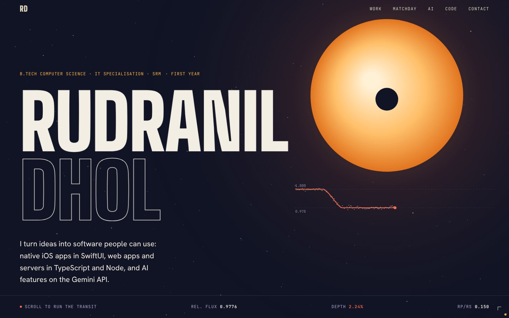
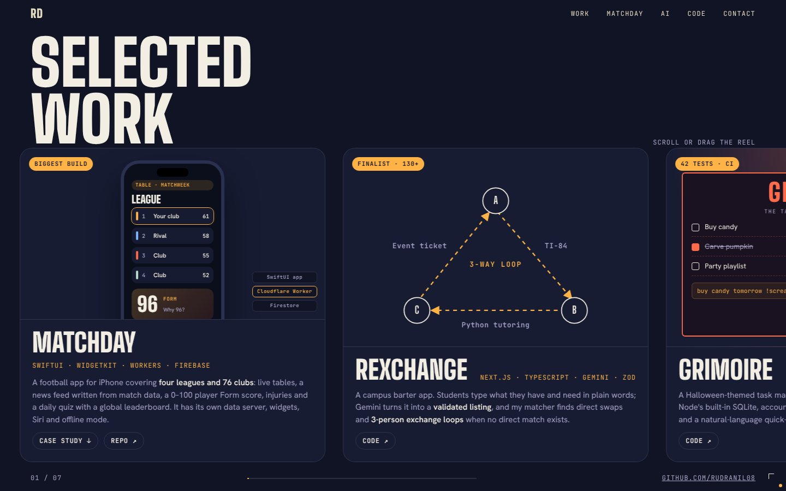
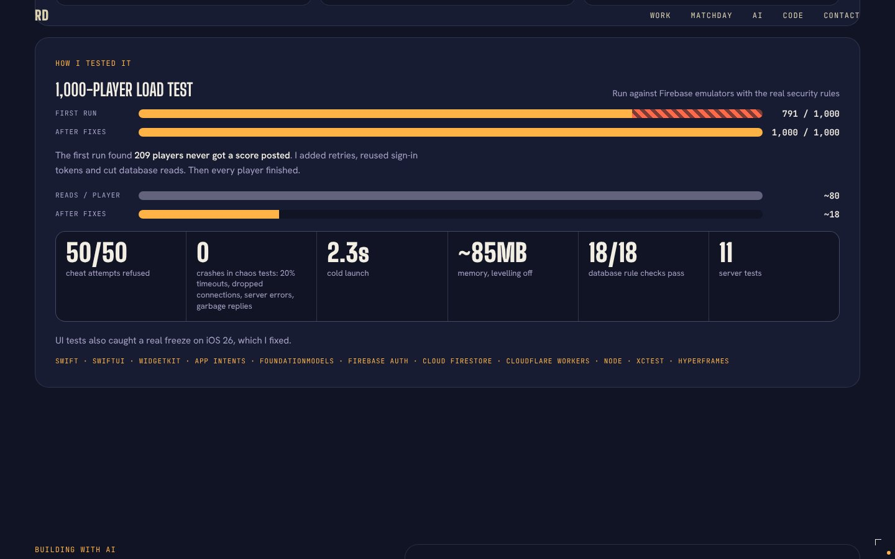
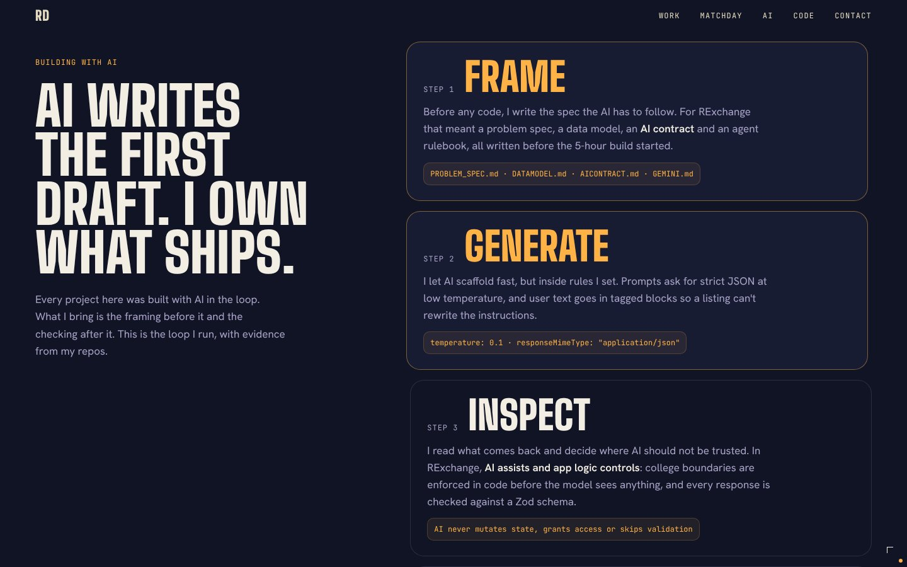

# Rudranil Dhol — Portfolio

**Live site:** https://rudranil08githubio.vercel.app



I'm a first-year B.Tech Computer Science (Information Technology specialisation) student at SRM Institute of Science and Technology. I build iOS apps in SwiftUI, web apps and servers in TypeScript and Node, and AI features on the Gemini API. This repo is my portfolio site.

I'm looking for **software engineering, iOS, product engineering and AI application internships**.

---

## What's on the site

| Project | What it is | Stack | Code |
|---|---|---|---|
| **Matchday** | My biggest build. A football app for iPhone covering four leagues and 76 clubs: live tables, a news feed written from match data, a 0–100 player Form score, injuries and a daily quiz with a global leaderboard. Has its own data server, widgets, Siri and offline mode. Load-tested with 1,000 simulated players. | Swift, SwiftUI, WidgetKit, App Intents, Cloudflare Workers, Firebase | [repo](https://github.com/rudranil08/Matchday) |
| **RExchange** | Campus barter app. Gemini turns plain-language posts into validated listings; a matcher finds direct swaps and 3-person exchange loops. Finalist, selected from 130+ participants. | Next.js, TypeScript, Gemini API, Zod | [repo](https://github.com/rudranil08/RExchange) |
| **Grimoire** | A Halloween-themed task manager with zero dependencies: REST API on Node's built-in SQLite, accounts, offline change queue, calendar feed and natural-language quick-add. 42 tests in CI on Node 22 and 24. | Node, SQLite, vanilla JS | [repo](https://github.com/rudranil08/Grimoire) |
| **TripWiseAI** | Native travel planner. Sends a structured trip request to Gemini and decodes the JSON reply into Swift types for a day-by-day itinerary. MVVM with a service layer. | Swift, SwiftUI, Gemini API | [repo](https://github.com/rudranil08/TripwiseAi) |
| **Roamly** *(in progress)* | iOS travel logbook. Detects the places you visit, verifies them with photo and GPS anti-cheat, and scores trips for novelty and sustainability. | Swift, SwiftUI, SwiftData, MapKit | [repo](https://github.com/rudranil08/Roamly) |
| **Qatar-1b transit analysis** | Independent research on NASA TESS data. Caught a BLS harmonic (2.84 d vs the true ~1.42 d), measured a 2.24% depth and ~1.17 Jupiter radii. | Python, Lightkurve, NumPy, Matplotlib | [repo](https://github.com/rudranil08/qatar1b_transit_analysis) |
| **QR Designer** | Client-side QR generator with live preview, logo overlay, PNG/SVG export and WCAG contrast warnings. | React, TypeScript, Vite | [live](https://qr-design-gdc.vercel.app/) · [repo](https://github.com/rudranil08/qr-design-gdc) |

The site also has a Matchday case study, a section on how I build with AI (frame → generate → inspect → verify), short code excerpts from these repos, my earlier web projects from 2023, and my film and photography work.



### Matchday case study

How the Form score works, how the app and its data server fit together, and how I tested it. The first 1,000-player load test found 209 players whose scores never posted. After I added retries, reused sign-in tokens and cut database reads (from about 80 to about 18 per player), every player finished and 50 of 50 cheat attempts were refused.



---

## How the site works

It's a single `index.html` file with no build step and no framework.

- **Scroll-driven transit.** The hero is a Canvas 2D scene. As you scroll, a planet crosses the star and the light curve plots in real time. The dip is computed from the actual circle-overlap geometry using my measured Rp/Rs of 0.1497, so it bottoms out at exactly 2.24%.
- **Pinned horizontal reel.** The projects section stays pinned while vertical scroll moves the cards sideways. You can also grab and fling it with a mouse, or swipe it on a phone, and it keeps momentum.
- **Smooth scrolling** with [Lenis](https://github.com/darkroomengineering/lenis), loaded from a CDN. If it fails to load, the page falls back to native scrolling.
- **Custom cursor.** A camera-style focus reticle that changes its label (DRAG, REPO, PROBE, OPEN) depending on what you hover over. It turns off on touch devices.
- **Interactive research plot.** Hover over the phase-folded light curve to read phase and flux values.
- **Accessible by default.** It respects `prefers-reduced-motion`, has keyboard focus states, works at phone width with no sideways scrolling, and keeps all text readable before any animation runs.



---

## Run it locally

```bash
git clone https://github.com/rudranil08/rudranil08.github.io.git
cd rudranil08.github.io
python3 -m http.server 8000
# open http://localhost:8000
```

You can also just double-click `index.html`.

## Deploy

The site is hosted on GitHub Pages: **Settings → Pages → Deploy from a branch → `main` / root**. The `.nojekyll` file tells Pages to serve the files as they are.

## Structure

```text
.
├── index.html        # the whole site: HTML, CSS and JS
├── assets/           # README screenshots and social preview image
├── .nojekyll
└── README.md
```

## Credits

- Fonts: [Big Shoulders Display](https://fonts.google.com/specimen/Big+Shoulders+Display), [Hanken Grotesk](https://fonts.google.com/specimen/Hanken+Grotesk) and [JetBrains Mono](https://fonts.google.com/specimen/JetBrains+Mono) via Google Fonts.
- Smooth scrolling: [Lenis](https://github.com/darkroomengineering/lenis).
- Built with AI assistance (Claude). I set the content, direction and structure, then reviewed and tested the result: the same workflow described on the site.

## Contact

- GitHub: [@rudranil08](https://github.com/rudranil08)
- LinkedIn: [rudranil-dhol-1222a3360](https://www.linkedin.com/in/rudranil-dhol-1222a3360/)
- Instagram: [@rudranilll](https://www.instagram.com/rudranilll/)
- YouTube: [@flakeyy007](https://www.youtube.com/@flakeyy007)
